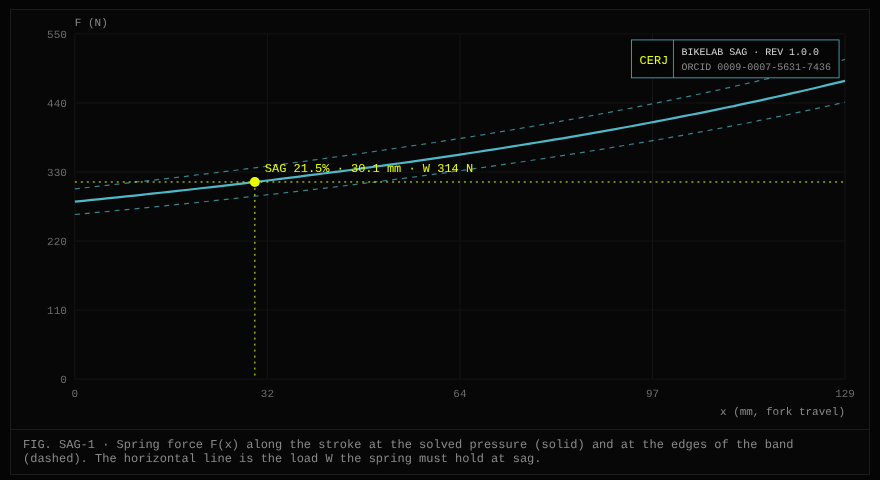

# BikeLab SAG Calculator

Designed and maintained by **Carlos Eduardo Ravello Joo** · ORCID [0009-0007-5631-7436](https://orcid.org/0009-0007-5631-7436) · BikeLab Studio, Trujillo, Peru

[](https://github.com/carlosravello-png/bikelab-sag-calculator/actions/workflows/verify.yml)
[](LICENSE.md)
[](https://doi.org/10.5281/zenodo.24484750)

Air-spring pressure for MTB forks and rear shocks at a target sag. This repository holds
the calculation engine, copied byte for byte from the live calculator, its golden vectors
and two verifiers. The green badge above is set by GitHub Actions, which runs both
verifiers on every change.



**Live demo, with the spring curve drawn:** https://carlosravello-png.github.io/bikelab-sag-calculator/
**Full calculator:** [ES](https://www.bikelabstudio.com/articles/sag-calculator-es.html) · [EN](https://www.bikelabstudio.com/articles/sag-calculator-en.html) · [PT](https://www.bikelabstudio.com/articles/sag-calculator-pt.html)

## Model — what the engine actually does

| Step | What the code does |
|---|---|
| Air spring | Positive chamber only: F(x, P) = P · A · (V0 / (V0 − A·x))^γ − Ff, with **γ = 1.30 for every model** |
| Volume | V0 = chamber volume minus installed tokens (each model carries its own volume and token volume) |
| Negative chamber | **Not modelled separately.** Each model carries a constant force term Ff that is subtracted |
| Load at sag | W = m · g · β / LR; β = 0.40 fork, 0.60 shock |
| Leverage (shocks) | Frame curve when catalogued (26 frames), else a generic curve by linkage type (6: Horst, VPP, DW, single pivot, Switch Infinity, high pivot), else a default by discipline (2.2 / 2.5 / 2.7 / 3.0) |
| Target sag | Middle of the discipline range (fork XC 15–20 %, Trail 20–23 %, Enduro 23–26 %, DH 25–28 %; shock 25–28 / 28–30 / 30–33 / 33–38 %), shifted by riding style |
| Pressure | Bisection on 20–500 psi until F(sag) = W (70 steps or 0.01 psi) |
| Band | **Fixed** ±15 / 10 / 7 / 5 % of the solved pressure by segment (entry / mid / mid-high / high) |
| Tokens | Tries 0–5 tokens and suggests the first whose end-stroke progression falls in the discipline window |
| Rebound / compression clicks | Heuristic formula; no validation published |

Database: **132 suspensions** (102 forks, 30 shocks) from **16 brands** — Fox, RockShox, Öhlins,
SR Suntour, Manitou, Marzocchi, DVO, Cane Creek, X-Fusion, Formula, MRP, Push Industries,
RST, Sturdy, Wintek, Zoom. Each model carries piston diameter, chamber volume, constant force
term and token volume. Calibrated MTB suspension dataset: DOI [10.5281/zenodo.20735088](https://doi.org/10.5281/zenodo.20735088).

## Reproduce

```
python verify_sag.py       # independent verifier, standard library only
node check_engine.js       # the real engine, Node.js 18+
```

Each prints `N/N checks passed` and exits with code 0 (today: 55/55 and 15/15).

| File | What it is |
|---|---|
| `sag_engine.js` | The engine, copied byte for byte from the live page on 2026-11-23 (SHA-256 of the copied block in its header). Only a module footer was added. Internal watermark: `SAG_MODEL_v5.0`, 2026-02-26. |
| `golden_vectors.json` | 13 cases (forks and shocks, four segments, frame curve, linkage curve and default leverage) produced by the engine, with the model data each one uses. |
| `verify_sag.py` | Verifier written from the model described above, not from the JavaScript: target sag, leverage, pressure and band for every vector, plus sign guards. |
| `check_engine.js` | Runs the engine against the vectors, checks the SHA-256 of the verbatim block, and compares the engine with the model on 5,304 inputs (102 forks × 4 disciplines × 13 rider masses). |
| `index.html` | Live demo of the same engine, with the force–travel curve. |

## Differences with white paper v3.0 (February 2026)

The white paper on bikelabstudio.com describes more than the published engine does. This
repository documents the engine as it is:

- The white paper speaks of a γ exponent calibrated per model between 1.00 and 1.40. The engine uses a single **γ = 1.30**.
- The white paper describes a dual-chamber model with an independent negative chamber. The engine models the **positive chamber** and a constant force term.
- The white paper reports Monte Carlo validation (10,000 iterations per model) and a confidence of 72–89 % by segment. **Neither runs in the engine**; the band shown to the rider is a fixed percentage. Those figures cannot be reproduced from what is published.
- The pages mention 10 brands and 33 frames; the database has **16 brands, 26 frames** and 6 generic linkage curves.

## Known limits

- For shocks without a catalogued frame, the wheel-sag percentage shown is computed against the shock stroke instead of the wheel travel, so it reads too high (e.g. 72.5 % instead of a value near 29 %). The pressure is not affected.
- Real air springs have a negative chamber, seal friction that varies with pressure, and temperature effects. None of these is modelled beyond the constant force term.
- The pressure is a starting point to be checked with a sag measurement on the bike.

## License and citation

Engine, vectors and verifiers: [PolyForm Noncommercial 1.0.0](LICENSE.md), free for any noncommercial use,
including research, teaching and personal use; commercial use needs written permission from
the author. Versions up to 1.0.0 were released under CC BY 4.0 and keep that licence.
Licence and attribution terms: https://carlosravello.com/licencia-en.html. Cite with the metadata in
[`CITATION.cff`](CITATION.cff); each release is archived on Zenodo with its own DOI.

> Ravello Joo, C. E. (2026). *BikeLab SAG Calculator* (Version 1.1.0) [Software]. Zenodo. https://doi.org/10.5281/zenodo.24549863

All versions: DOI [10.5281/zenodo.24484750](https://doi.org/10.5281/zenodo.24484750). Code of version 1.1.0 archived in Software Heritage: [swh:1:rev:182966336534d7e502bf9a26350981fa5c47242b](https://archive.softwareheritage.org/swh:1:rev:182966336534d7e502bf9a26350981fa5c47242b).
Previous archived version (June 2026): DOI [10.5281/zenodo.20672790](https://doi.org/10.5281/zenodo.20672790).
